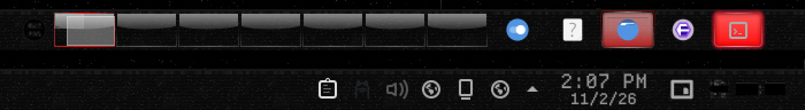

# Redacted — Plasma Style

Black for the Plasma panel, popups and tooltips: faint grain, a censor-pixel mosaic and a stepped seam a few levels above black.



Redacted is a monochrome-black look for KDE Plasma 6 about obfuscation and censorship. Every colour is a neutral grey, and the accents sit only a few levels above black: almost imperceptible, but just perceptible. The motifs are static, mosaic pixelation, black censor bars and a dissociated double.

## Features

- Panel, popups and dialogs, tooltips and widget backgrounds in near-black.
- Faint grain and a sparse censor-pixel mosaic, tiled 1:1 so they never smear at any panel size.
- A stepped seam along the edge, a breath lighter than black.
- Translucent variants with blur, plus solid variants for when compositing is off.
- Buttons, sliders and task highlights follow your colour scheme, so pair it with the Redacted colours.


## Requirements

Plasma 6.

## Install

```bash
git clone https://github.com/numbpill3d/redacted-plasma
cd redacted-plasma && ./install.sh
```

Or from the KDE Store: System Settings → Colors & Themes → Plasma Style → Install from File, or extract it to `~/.local/share/plasma/desktoptheme/`.

## The rest of the suite

| piece | repo |
|---|---|
| Global theme + splash screen | [redacted-global](https://github.com/numbpill3d/redacted-global) |
| Aurorae window decoration | [redacted-aurorae](https://github.com/numbpill3d/redacted-aurorae) |
| Colour scheme | [redacted-colors](https://github.com/numbpill3d/redacted-colors) |
| Kvantum widget style | [redacted-kvantum](https://github.com/numbpill3d/redacted-kvantum) |
| Icon theme | [redacted-icons](https://github.com/numbpill3d/redacted-icons) |
| Konsole + kitty colours | [redacted-konsole](https://github.com/numbpill3d/redacted-konsole) |
| SDDM login | [redacted-sddm](https://github.com/numbpill3d/redacted-sddm) |
| Plymouth boot splash | [redacted-plymouth](https://github.com/numbpill3d/redacted-plymouth) |
| Animated wallpaper (desktop + lock) | [redacted-wallpaper](https://github.com/numbpill3d/redacted-wallpaper) |
| Still wallpaper (1080p–4K) | [redacted-image-wallpaper](https://github.com/numbpill3d/redacted-image-wallpaper) |
| KWin open/close effect | [redacted-censor](https://github.com/numbpill3d/redacted-censor) |
| KWin script: active window under review | [redacted-static](https://github.com/numbpill3d/redacted-static) |
| Clock plasmoid | [redacted-clock](https://github.com/numbpill3d/redacted-clock) |

Everything at once, with the generators: [redacted-kde](https://github.com/numbpill3d/redacted-kde).

## Tags

`redacted` `kde` `plasma6` `dark` `black` `monochrome` `grayscale` `minimal` `censored` `glitch` `static` `pixel` `plasma-style` `desktoptheme` `panel` `plasma-theme` `translucent`

## Credits and licence

By splicer scorn (voidrane). GPL-3.0-or-later.
